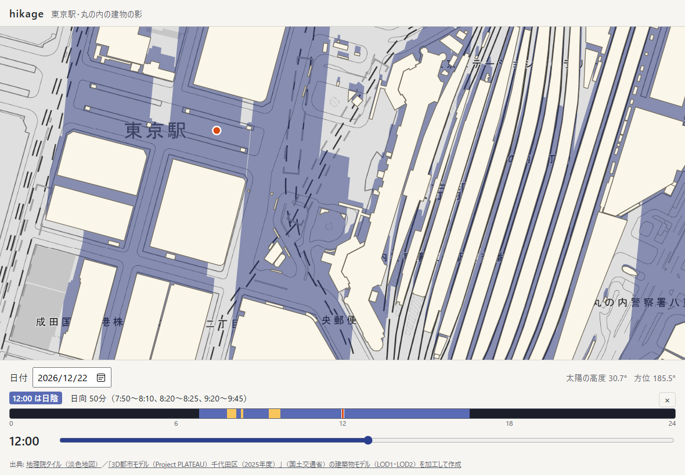
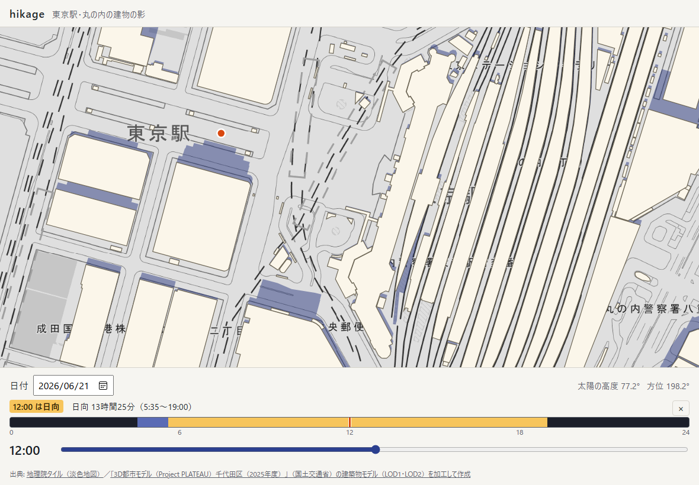
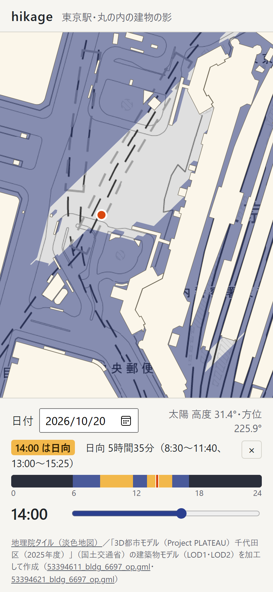
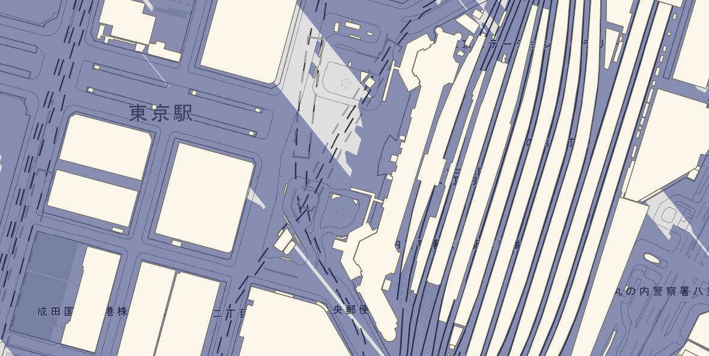
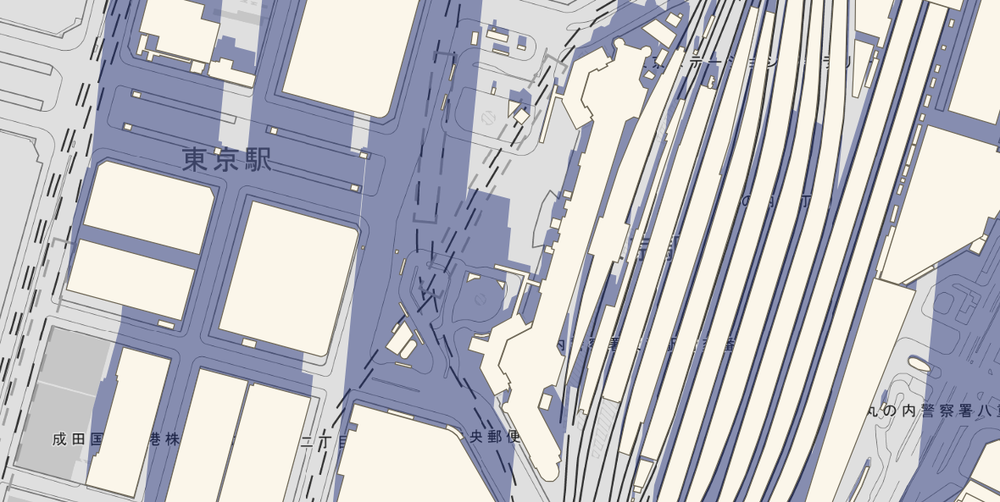
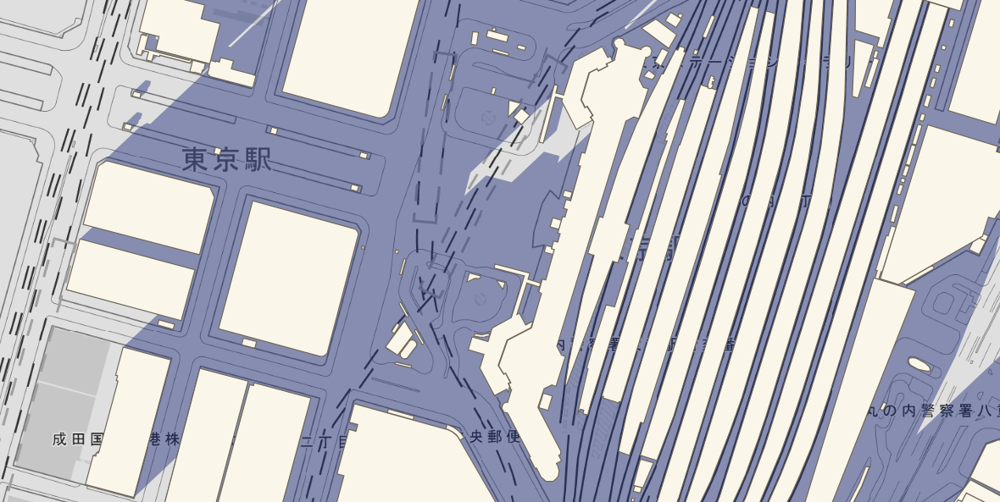

# hikage

東京駅・丸の内の建物の影を、日付と時刻を指定して地図に描く。地図を押すと、その地点がその日いつ日向でいつ日陰かを帯で示す。

**アプリ:** https://tame0522works-art.github.io/hikage/ （PC とスマホのブラウザで、開くだけで使える。地図を押すと、その地点のその日の日向・日陰が出る）



建物は国土交通省の 3D 都市モデル（PLATEAU）、太陽の位置は天文計算で求め、影はどちらも端末の中で計算する。
公開版は Content Security Policy で通信（fetch など）をすべて禁じ、例外は背景の地理院タイルの画像を読むことだけにしている。

## できること

| 同じ地点の夏至の正午（日向 13時間25分） | スマホ |
|---|---|
|  |  |

| 冬至 9:00 | 冬至 12:00 | 冬至 15:00 |
|---|---|---|
|  |  |  |

- **日付と時刻で影が動く**: 5 分刻みのスライダーで、建物の影の向きと長さが変わる。太陽の高度と方位も出す
- **地点の1日**: 地図を押すと、その地点の 0〜24 時を 5 分ごとに日向・日陰・夜に分けた帯と、日向の合計・時間帯を出す。帯を押す（なぞる）とその時刻に移る。建物の中を押したらその旨を出す
- **動かせる地図**: ドラッグ・ホイール・2本指で動かす。対象は東京駅を含む 約1.2km × 2km（建物 2,345 棟）

## 作りの要点

### PLATEAU の 2GB の ZIP から、要る2ファイルだけを取り出す

PLATEAU の CityGML は区ごとの ZIP（千代田区の 2025 年度版で 2.1GB）で配られている。使うのは東京駅を含む約 1km 四方のメッシュ2つ分の建物ファイルだけなので、
ZIP の中央ディレクトリ（ZIP64 を含む）を自前で読み、HTTP の Range で必要な範囲だけを取り出す（[`tools/zip.ts`](tools/zip.ts)、1ファイル約1秒）。

東京駅は千代田区と中央区（八重洲側）の境にあるので、最初は両方の区の ZIP から同じメッシュを取った。比べると CRC まで一致した。
東京都の建物ファイルはメッシュ単位で、区の境をまたいで同じ建物が入っている。それが分かったので、千代田区の ZIP だけを使っている。

### LOD1 では、超高層の影が半分の長さになる

最初は建物を単純な柱（LOD1: 底面と高さ）として影を落とす計画だった。ところが変換してみると、LOD1 の高さは建物全体を1本の柱にならした値だった。
低層部の上に塔が立つ超高層ほど、実際より低くなっていた。

| 建物 | LOD1 の高さ | LOD2 の屋根の最高点 | PLATEAU の measuredHeight |
|---|---|---|---|
| 丸の内ビルディング | 99.9m | 179.3m | 180.1m |
| グラントウキョウ ノースタワー | 92.5m | 205.3m | 202.3m |
| 新丸の内ビルディング | 139.2m | 197.3m | 199.9m |

影の主役になる建物の影が、半分ほどの長さになってしまう。そこで影は LOD2 の屋根面（2,345 棟で 24,278 面）ごとに「屋根面から地面まで下ろした柱」として落とし、LOD1 は地図に描く輪郭と「建物の中か」の判定にだけ使う。
変換後のデータは 2.4MB（gzip で 668KB）で、アプリに同梱している（[`src/data/marunouchi.json`](src/data/marunouchi.json)、座標は東京駅を原点にした cm の整数）。

### 太陽の位置は、国立天文台の値と比べる

太陽の高度と方位は J. Meeus『Astronomical Algorithms』の式で求める（[`src/sun.ts`](src/sun.ts)。章動・光行差・地平視差・大気差を入れている）。
国立天文台 暦計算室「天体の高度と方位」から東京駅の地点の値を取得した（[`tools/naoj.ts`](tools/naoj.ts)。7日分を10分ごと、大気差あり・なしの両方）。
`check:sun` で全時刻を比べていて、差は高度 0.0073°・方位 0.0159° 以内。
許容は 0.02° で、高さ 200m の建物の影の先端なら、太陽高度 10° で約 1.3m のずれにあたる。
大気差を外すと 0.30°、時刻を1分ずらすと 0.21° の差になり、テストが落ちることも確かめた。

### 影の形と、重なりに穴をあけない塗り方

1つの屋根面の柱の影は、次の3種類の多角形を合わせた範囲になる。

1. 柱の底面
2. 屋根面の各点を「高さ ÷ tan(太陽高度)」だけ太陽と反対へずらした形
3. 底面の辺とずらした辺を結ぶ四角形

すべてを反時計回りにそろえれば、1つのパスにして nonzero で塗るだけで合併になる（向きが混ざると、重なった所で巻き数が打ち消し合って穴があく）。
ただし多角形が多すぎるので、屋根面が凸なら1つにまとめる。凸な立体を平行な光で地面に写した影は凸で、頂点を写した点の凸包に等しいからだ。
平らな凸の屋根面（大半がこれ）は、多角形を1方向に伸ばした形として並べ替えなしの1周で作る。
これで多角形は 15.7 万個から 5.1 万個になり、全体の影の計算は約 6ms で終わる（`npm run bench`）。

`check:shadow` では、手で答えの出せる形（箱・低層部と塔・片流れの屋根・L字の屋根・夜）の影を 47,816 地点で答えと比べている。
実データでは、描く多角形（巻き数）と地点の判定が一致し、巻き数が負にならないことを確かめる。
向きをそろえる処理を外すと、テストが落ちる。

### ブラウザで測って直した、描画の遅さ

計算は速かったのに、ブラウザで動かすと時刻を1回動かすたびにページが固まった。ブラウザ枠で1段ずつ測って直した。

| 測ったこと | 直す前 | 直した後 |
|---|---|---|
| 多角形を1本のパスで塗る | 6.4 万個で 29ms だったが、9.6 万個を超えると数十秒 | 2 万個ずつに分け、別の canvas に不透明で塗ってから半透明で重ねる（分けても重なりが濃くならない） |
| Path2D に moveTo / lineTo を積む | 5.1 万個・27 万点で 2.7 秒 | SVG のパス文字列から `new Path2D(文字列)` で作る（約 0.1 秒） |
| 時刻を1回動かす（公開版、1200×573、1px 0.6m） | 計算 約38ms ＋ 描画 | 画面に映る範囲と余白（幅・高さの半分ずつ）の影だけ計算し、計算込みの描画で約 11ms |

地図を全体が入るまで引いたとき（1px 4m）は、映る範囲を絞れないので約 40ms かかる。

### 地点の1日の日向・日陰

押した地点から、0 時から 5 分ごとに「太陽が出ているか」「影の中か」を調べる（288 時刻で約 15ms）。
`check:timeline` では、昼の長さを国立天文台「日の出入り」の東京の値と比べる（夏至 4:25〜19:00、冬至 6:47〜16:32、5 分刻みの粗さの分 ±10 分）。
時刻ごとの判定が影の地点判定と一致することも確かめている。
行幸通り（丸ビルと新丸ビルの間）の日向は、夏至が 13時間25分、冬至が 50分。

### 通信するのは地図の画像だけ

これまでの作品と同じく、公開版は CSP の `connect-src 'none'` で fetch などの通信をすべて拒否する。地理院タイルだけを `img-src` で許している。
タイルは CORS を許可している（`Access-Control-Allow-Origin: *`）。そこで `crossOrigin = 'anonymous'` で読み、Cookie などの資格情報を送らない。
canvas も汚れないので、描いた結果を読み出して画面テストで確かめられる。
タイルの要求からわかるのは「どのあたりの地図を見ているか」だけで、押した地点や日時は送らない。

## 確かめ方

```bash
npm run check   # zip / convert / data / sun / shadow / timeline
npm run e2e     # 公開と同じ設定でビルドし、画面なしの Chrome でマウスとタッチの操作を送る（7件、地理院タイルを読むのでネットが要る）
npm run bench   # 影の計算の速さ
```

画面テスト（[`tools/e2e.ts`](tools/e2e.ts)）で確かめていること:

- 開くと地図・建物・影と出典が出る
- 冬至の朝は夏至の正午より影が広く、夜は影を描かない
- 地点を押すと帯が出て、帯を押すと時刻が移る
- 建物の中を押したときの案内
- ドラッグは押した判定にならない
- 公開版の CSP（fetch は拒否、タイルの画像は読める）
- スマホで指で押せて横にはみ出さない

README の画像は `npm run build` → `npm run preview` のあとに `npm run screenshots` で撮り直せる。

## 扱っていないこと

- 地面は平らとみなしている（丸の内はほぼ平らだが、坂や地下の出入口の段差は見ていない）
- 影は地面にだけ落とし、ほかの建物の屋上や壁に落ちる影は描かない
- 樹木・高架・看板・駅の上屋のうち PLATEAU の建築物モデルにないものの影は入らない
- 建物は PLATEAU 2025 年度版の時点のもの。その後に建った・壊された建物は反映されない
- 1日の帯は 5 分刻み。大気差は標準的な大気（気温 10℃・1010hPa）で計算している

## データの出典

- 建物: 「3D都市モデル（Project PLATEAU）千代田区（2025年度）」（国土交通省）の建築物モデル（LOD1・LOD2）を加工して作成。
  [G空間情報センターのデータセットページ](https://www.geospatial.jp/ckan/dataset/plateau-13101-chiyoda-ku-2025)。
  利用条件は [PLATEAU のサイトポリシー](https://www.mlit.go.jp/plateau/site-policy/)（公共データ利用規約 第1.0版、CC BY 4.0 互換）
- 地図: [地理院タイル](https://maps.gsi.go.jp/development/ichiran.html)（淡色地図）を灰色にして表示
- 太陽の位置の検証: [国立天文台 暦計算室](https://eco.mtk.nao.ac.jp/koyomi/)「天体の高度と方位」「日の出入り」

## 開発

```bash
npm install
npm run dev            # http://localhost:5195/
npm run fetch:plateau  # PLATEAU の ZIP から建物ファイルを raw/ に取り出す（raw/ は git に入れない）
npm run convert        # raw/ を src/data/marunouchi.json に変換する
npm run naoj           # 国立天文台から太陽の参照値を取り直す（tools/sun-reference.json）
```
